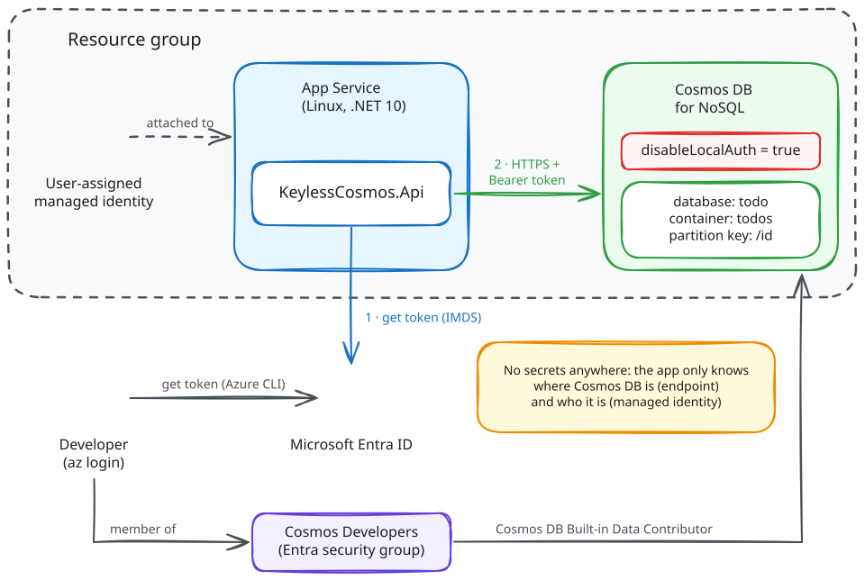

# Keyless Azure Cosmos DB with Managed Identity + Bicep 🔐

> [!NOTE]
> 📖 **Blog article:** [Go keyless in Azure Cosmos DB](https://www.benjaminbork.com/blog/go-keyless-in-azure-cosmos-db/)

Use Azure Cosmos DB for NoSQL **without access keys**: no connection strings, no Key Vault secrets, no key rotation. A .NET 10 minimal API on App Service talks to Cosmos DB with a **user-assigned managed identity** and **Cosmos DB native data-plane RBAC**, all deployed with Bicep.



## Run 🚀

```bash
azd auth login
```

```bash
azd up
```

## Clean up 🧹

```bash
azd down --purge
```
